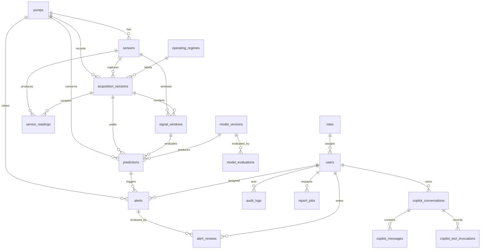

# Database schema

**Version:** 0.6 — migrations `45fcb5e34b91` (initial), `a7fc07ebdf60` (Stage 2),
`bb5d543b303c` (Stage 3 indexes), `cc4e2d9b7f12` (Stage 4 runtime enum),
`f320ab275929` (Stage 5 alert uniqueness), `6ab8b0723c85` (Copilot conversations/invocations) and
`b7f0c2a4d910` (model display-name branding)
**Engine:** SQLite (WAL, foreign keys enabled). PostgreSQL is a later deployment option.

## 1. Relationship overview



## 2. Table catalogue

All tables use UUID string primary keys except `sensor_readings` and `audit_logs` (auto-increment
integers), `sync_outbox` (`event_id` string primary key) and `roles` (UUID). Timestamps are stored
as timezone-aware `DATETIME` values; the UI presents UTC.

### `roles`

- `id`, `name` (unique enum: `ADMINISTRATOR`, `ENGINEER`, `RESEARCHER`, `REVIEWER`), `description`, `created_at`.
- Seeded reference rows; no user-facing role deletion.

### `users`

- `id`, `email` (unique), `username` (unique), `full_name`, `password_hash` (Argon2), `role_id`, `is_active`, `must_change_password`, `token_version`, `last_login_at`, `created_at`, `updated_at`.
- Index: `(role_id, is_active)`.
- Accounts are deactivated, never hard-deleted through the API.
- `token_version` increments on credential reset/revocation and invalidates outstanding tokens.

### `pumps`

- `id`, `pump_code` (unique), `name`, `pump_type`, `location`, `rated_speed_rpm`, `default_regime_id` (nullable FK), `status` (`ACTIVE`, `MAINTENANCE`, `RETIRED`), `notes`, `registered_at`, `created_by_id`, `created_at`, `updated_at`.
- Index: `default_regime_id`.
- Pump codes are normalised to uppercase by the API.
- Retirement is a status transition. Historical evidence remains linked.

### `sensors`

- `id`, `sensor_code` (unique), `pump_id` (nullable until assigned), `sensor_type` (`VIBRATION`, `RPM`, `TEMPERATURE`), `manufacturer`, `model_name`, `mounting_axis`, `mounting_position`, `sampling_rate_hz`, `is_active`, `installed_at`, `created_at`, `updated_at`.
- Optional channels such as RPM/temperature exist in the schema but only appear in the UI when the
  corresponding hardware is connected and readings exist.

### `operating_regimes`

- `id`, `code` (unique), `name`, `description`, `is_active`, `created_at`.
- Seed values: `STEADY_STATE`, `STARTUP`, `SHUTDOWN`, `VARIABLE_LOAD`, `UNKNOWN`.

### `acquisition_sessions`

- `id`, `pump_id`, `sensor_id`, `regime_id`, `started_by_id`, `source_device_id`, `sampling_rate_hz`, `data_provenance`, `random_seed`, `scenario`, `status` (`ACTIVE`, `COMPLETED`, `ABORTED`), `started_at`, `ended_at`, `notes`, `created_at`.
- Indexes: `(pump_id, started_at)`, `(sensor_id, started_at)`, `(data_provenance, started_at)`,
  `scenario`.
- `scenario` records the deterministic simulation scenario for simulated runs.
- The Stage 2 API accepts only `SIMULATED` sessions; experimental acquisition is rejected until
  physical hardware is validated.
- Sessions are bounded; this bounds raw waveform and reading accumulation.

### `sensor_readings`

- `id` (integer PK), `session_id`, `sensor_id`, `sequence_no`, `recorded_at`, `value` (nullable for unusable input), `unit`, `quality_status`, `validation_message`, `created_at`.
- Unique: `(session_id, sequence_no)` prevents duplicate ingestion.
- Indexes: `(session_id, recorded_at)`, `(sensor_id, recorded_at)`.
- Intended for scalar/aggregated measurements rather than high-frequency waveforms.

### `signal_windows`

- `id`, `session_id`, `sensor_id`, `window_index`, `window_start`, `window_end`, `sampling_rate_hz`, `sample_count`, `payload_encoding` (`float32-le`), `signal_payload` (binary, nullable for retention purging), `features` (JSON), `quality_status`, `validation_summary` (JSON), `data_provenance`, `created_at`.
- Unique: `(session_id, window_index)`.
- Indexes: `(session_id, window_start)`, `(sensor_id, created_at)`, `(data_provenance, window_start)`.
- High-frequency waveform data lives here, separate from ordinary reading rows.
- Stage 2 stores valid waveform payloads as little-endian float32 bytes. Sensor-invalid windows
  preserve timestamps, quality and validation summary with no sample payload.
- A valid window's sample count and duration are checked at ingestion; duplicate window indexes are
  rejected.

### `model_versions`

- `id`, `model_code`, `name`, `version`, `algorithm`, `runtime` (`ONNX`, `SKLEARN`, `TFLITE`, `BASELINE`, `LINEAR_JSON`), `feature_contract` (JSON), `training_dataset_version`, `evaluation_dataset`, `evaluation_summary` (JSON), `deployment_compatibility` (JSON), `artifact_path`, `artifact_sha256`, `status` (`REGISTERED`, `VALIDATED`, `ACTIVE`, `RETIRED`, `REJECTED`), `registered_by_id`, `registered_at`, `validated_at`, `activated_at`, `retired_at`, `notes`.
- Unique: `(model_code, version)`.
- Status transitions are service-controlled; the database alone is not the activation policy.
- Current activation supports `BASELINE` and `LINEAR_JSON`; other runtimes remain metadata-only.

### `model_evaluations`

- `id`, `model_version_id`, `dataset_name`, `dataset_version`, `data_provenance`, `evaluation_protocol`, `split_description`, `sample_count`, `balanced_accuracy`, `macro_f1`, `metrics` (JSON), `confusion_matrix` (JSON), `risk_coverage` (JSON), `calibration` (JSON), `is_verified`, `verified_by_id`, `verified_at`, `evaluated_by`, `evaluated_at`, `notes`.
- Indexes: `(model_version_id, evaluated_at)`, `(data_provenance, evaluated_at)`.
- "Not yet evaluated" is represented by the absence of a verified evaluation, not a fabricated metric.

### `predictions`

- `id`, `event_id` (unique durable identifier), `pump_id`, `sensor_id`, `session_id`, `signal_window_id` (nullable for sensor-invalid cases), `model_version_id` (nullable when no inference occurred), `operating_regime_id`, `decision` (`NORMAL`, `FAULT`, `UNCERTAIN`, `SENSOR_INVALID`), `data_quality`, `equipment_condition`, `decision_score`, `uncertainty_score`, `explanation`, `latency_ms`, `inferred_at`, `data_provenance`, `created_at`.
- Indexes: `(pump_id, inferred_at)`, `(decision, inferred_at)`, `(data_provenance, inferred_at)`.
- Predictions are immutable evidence. Reviews link to them; they never update them.

### `alerts`

- `id`, `event_id` (unique), `pump_id`, `sensor_id`, `prediction_id`, `category` (`FAULT`, `UNCERTAIN`, `SENSOR_INVALID`), `severity`, `status` (`OPEN`, `ACKNOWLEDGED`, `REVIEWED`, `CLOSED`, `DISMISSED`), `title`, `description`, `origin_device_id`, `data_provenance`, `assigned_reviewer_id`, `acknowledged_at`, `closed_at`, `created_at`, `updated_at`.
- `prediction_id` is uniquely constrained by `uq_alerts_prediction_id`, so a prediction can own at
  most one alert.
- Indexes: `(status, created_at)`, `(pump_id, created_at)`, `(category, created_at)`.

### `alert_reviews`

- `id`, `alert_id`, `reviewer_id`, `action` (`ACKNOWLEDGE`, `REVIEW`, `CONFIRM_LABEL`, `CORRECT_LABEL`, `ADD_NOTE`, `CLOSE`), `reviewed_label`, `notes`, `label_source` (`ENGINEER_REVIEW` etc.), `is_verified_ground_truth` (default false), `created_at`.
- Index: `(alert_id, created_at)`.
- Append-only; no API updates or deletes.

### `configuration_settings`

- `id`, `key` (unique), `value` (JSON), `category`, `description`, `updated_by_id`, `created_at`, `updated_at`.
- Seeded thresholds and defaults. Changes are audited when the Stage 7 API is added.

### `sync_outbox`

- `event_id` (PK), `event_type`, `source_device_id`, `occurred_at`, `payload_version`, `payload` (JSON), `delivery_status` (`PENDING`, `IN_FLIGHT`, `DELIVERED`, `FAILED`, `DEAD_LETTER`), `retry_count`, `next_retry_at`, `last_error`, `created_at`, `delivered_at`.
- Indexes: `(delivery_status, next_retry_at)`, `(occurred_at)`, `(event_type)`.
- Edge-local; API ingestion must deduplicate by domain `event_id` and return idempotent results.

### `audit_logs`

- `id` (integer PK), `actor_user_id` (nullable), `actor_label`, `action`, `entity_type`, `entity_id`, `before` (JSON), `after` (JSON), `ip_address`, `user_agent`, `request_id`, `created_at`.
- Indexes: `(created_at)`, `(action, created_at)`, `(entity_type, entity_id)`.
- Append-only by policy. No application delete endpoint.

### `report_jobs`

- `id`, `report_type`, `status` (`QUEUED`, `RUNNING`, `COMPLETED`, `FAILED`), `requested_by_id`, `parameters` (JSON), `includes_simulated_data`, `file_path`, `file_sha256`, `error_message`, `created_at`, `started_at`, `completed_at`.
- Index: `(status, created_at)`.
- Reports include dataset, model version, timestamps and provenance.

## 3. Stage 2 write paths

- Pump registration with an optional nested first sensor is a single transaction; duplicate sensor
  code rolls back the pump.
- Sensor registration/update validates pump association.
- Acquisition session creation validates that the sensor belongs to the pump, is active, matches the
  configured sampling rate, and is simulated.
- Window ingestion validates session activity, duplicate index, finite valid samples, sample count
  versus duration, and sensor-invalid summary requirements.
- Equipment and session lifecycle changes are audited; individual window ingestion is not audited
  per window to avoid log flooding.

## 4. Stage 3 monitoring queries

- Live snapshots read the latest windows for a sensor ordered by `created_at`, using the new
  `(sensor_id, created_at)` index, and decode only a bounded waveform preview.
- Sensor diagnostics aggregate window quality counts, last reading/last valid reading, missing index
  gaps in the latest session and the latest validation issues.
- SSE new-window detection polls persisted windows by pump/sensor and ingestion time; it does not
  introduce a new table or in-memory event store.
- Equipment condition remains unset because no prediction/model record exists in Stage 3.
- No raw waveform bytes are returned by monitoring JSON endpoints; only downsampled preview values.

## 5. Stage 4–5 inference, prediction and alert writes

- `model_versions` stores metadata, artefact hash, feature contract and lifecycle status; no model
  binary is executed by the API.
- `model_evaluations` stores synthetic or experimental evaluation evidence, including provenance,
  metrics, confusion matrix, risk–coverage and calibration JSON. A verified evaluation is required
  for validation/activation.
- `predictions` links a decision to pump, sensor, session, window, model version and operating
  regime. `event_id` is unique. Sensor-invalid predictions have no model and no scores.
- Predictions are append-only evidence. Reviews reference alerts/predictions rather than editing them.
- `FAULT`, `UNCERTAIN` and `SENSOR_INVALID` predictions create a reviewable alert inside the same
  transaction unless the relevant `alerts.auto_create_for_*` setting is disabled. The alert copies
  pump, sensor, provenance and prediction links; the prediction remains the source of truth.
- `alert_reviews` is append-only. Engineering labels use `label_source = ENGINEER_REVIEW` and
  `is_verified_ground_truth = false`; no API path promotes a review to verified ground truth.
- Alert acknowledgement/review updates only alert workflow fields (`status`, reviewer, timestamps)
  and appends a review plus audit entry; prediction values are never updated.
- Feature values are stored on the signal window; prediction APIs validate them against the model
  feature contract.
- Model activation retires the previous active version; old versions remain for rollback/history.
- No new high-frequency storage path was introduced in Stage 4.

### `copilot_conversations`

- `id`, `user_id`, `title`, `context` (JSON typed page-context snapshot), `created_at`, `updated_at`.
- Index: `(user_id, updated_at)`.
- Conversations are owner-scoped; the API never returns another user's conversation.

### `copilot_messages`

- `id`, `conversation_id`, `role` (`USER`, `ASSISTANT`, `SYSTEM`), `content`, `payload` (JSON:
  actions, suggested questions, tool-run IDs, approval ID), `created_at`.
- Index: `(conversation_id, created_at)`.
- Messages are append-only from the API. Clearing the UI conversation starts a new conversation
  rather than rewriting history.

### `copilot_tool_invocations`

- `id`, `conversation_id` (nullable for explicit read-only tool calls), `actor_user_id`, `tool_name`,
  `arguments` (exact JSON), `requires_approval`, `status` (`EXECUTING`, `PENDING_APPROVAL`,
  `EXECUTED`, `FAILED`, `REJECTED`), `result` (JSON), `error`, `idempotency_key` (unique nullable),
  `created_at`, `completed_at`.
- Indexes: `(conversation_id, created_at)`, `(status, created_at)`, `(actor_user_id, created_at)`.
- Write tools are never executed during chat planning. Approval revalidates the actor, target and
  exact stored arguments before invocation; repeated approval returns the existing result.
- Tool results are untrusted data and are size-limited by the MCP client.

## 6. Traceability chain

```text
Pump → Sensor → AcquisitionSession → SignalWindow → Prediction → Alert → AlertReview
```

- The chain is retained independently of sync state.
- `Prediction.event_id` and `Alert.event_id` are globally unique for idempotent ingestion.
- A review references the alert, which references the original prediction. The review never
  rewrites prediction values.

## 7. Provenance and labelling

- `acquisition_sessions.data_provenance`, `signal_windows.data_provenance`,
  `predictions.data_provenance`, `alerts.data_provenance` and
  `model_evaluations.data_provenance` are mandatory.
- Engineer review labels use `label_source = ENGINEER_REVIEW` and
  `is_verified_ground_truth = false` by default.
- Verified ground truth requires a separate verification workflow backed by experimental run
  identifiers; it is not produced by the review action alone.

## 8. Retention and storage budget

- Raw waveform volume: a 2048-sample float32 window is 8 KiB. At one window per second, continuous
  recording would be about 691 MiB/day. Continuous high-frequency recording is therefore not the
  intended operating mode.
- Sessions are bounded (for example, a 10-minute steady-state run is about 4.8 MiB of waveform
  payload at one window per second). The default retention is 30 days for raw readings/windows.
- Retention jobs will null `signal_payload` or remove expired rows while preserving prediction,
  alert and review evidence. The precise purge job is implemented in a later stage.
- Storage limits and retention are configurable and must be validated before saving.
- PostgreSQL migration is recommended if the rig produces sustained high-frequency recordings.

## 9. Deletion and audit policy

- No hard delete of users, pumps, predictions, alerts or reviews through the API.
- Users are deactivated; pumps are retired.
- Raw measurements may be purged under the documented retention policy.
- Audit logs are append-only; database-level retention/archival is an operational decision.
- Foreign keys use `RESTRICT` for evidence relationships and `CASCADE` only for a session's raw
  readings/windows, so accidental deletion of an acquisition session has a bounded effect.
